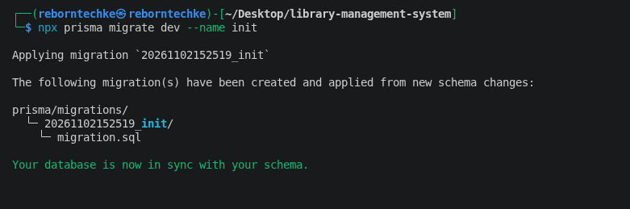

# Library Book Catalog Data Layer

This project implements the robust backend data layer for a library's book catalog using **Prisma ORM** and **PostgreSQL**.

---

## Schema Decisions

### Why `Book` References `Genre` Rather Than Embedding It

In relational database design, genres represent discrete categories shared across multiple books. We implemented a normalized relational architecture where `Book` references `Genre` via a foreign key (`genreId`) with an explicit `@relation` definition rather than embedding genre data inside each book record for the following reasons:

1. **Data Consistency & Single Source of Truth:** By separating genres into their own table, we ensure names (e.g., "Science Fiction") are standardized. Updating or renaming a genre updates it globally without risk of update anomalies or typos.
2. **Normalized Architecture:** Normalization minimizes data duplication, optimizing storage and write performance.
3. **Extensibility:** A dedicated `Genre` model allows us to easily attach additional metadata (such as descriptions, category icons, or parent-child hierarchical categories) in the future without altering the `Book` schema.
4. **Relational Queries:** Prisma makes joining related tables effortless (`include: { genre: true }`), allowing us to fetch books along with their complete genre context seamlessly.

---

## Database Migration & Verification

The Prisma schema was successfully migrated to PostgreSQL using Prisma Migrate.

**Command executed:**

```bash
npx prisma migrate dev --name init
```

**Migration result:**

- Database provider: PostgreSQL
- Database schema: `public`
- Migration name: `20261102152519_init`
- Migration status: Successfully created and applied.
- Database status: In sync with the Prisma schema.

The generated migration file is located at:

```text
prisma/migrations/20261102152519_init/migration.sql
```

The migration was successfully applied, confirming that the database structure matches the Prisma schema.



## Stretch Goals Implemented

- **Review Model:** Added a `Review` model establishing a relational link between `Book` and `User` to track ratings (`1-5`) and written feedback.
- **Prisma (Relational) vs. Document Database Modeling:**
  * **Prisma / PostgreSQL:** Requires upfront schema definition, strict types, and referential integrity constraints. Relationships are explicitly declared via foreign keys and resolved using joins or client includes, making it ideal for highly structured, predictable domains with complex relations.
  * **Document Database (e.g., MongoDB):** Emphasizes flexible, schema-less structures where genres or reviews could be embedded directly within a book document. While this optimizes single-document reads, updating embedded data across multiple documents can introduce data duplication overhead and consistency challenges.